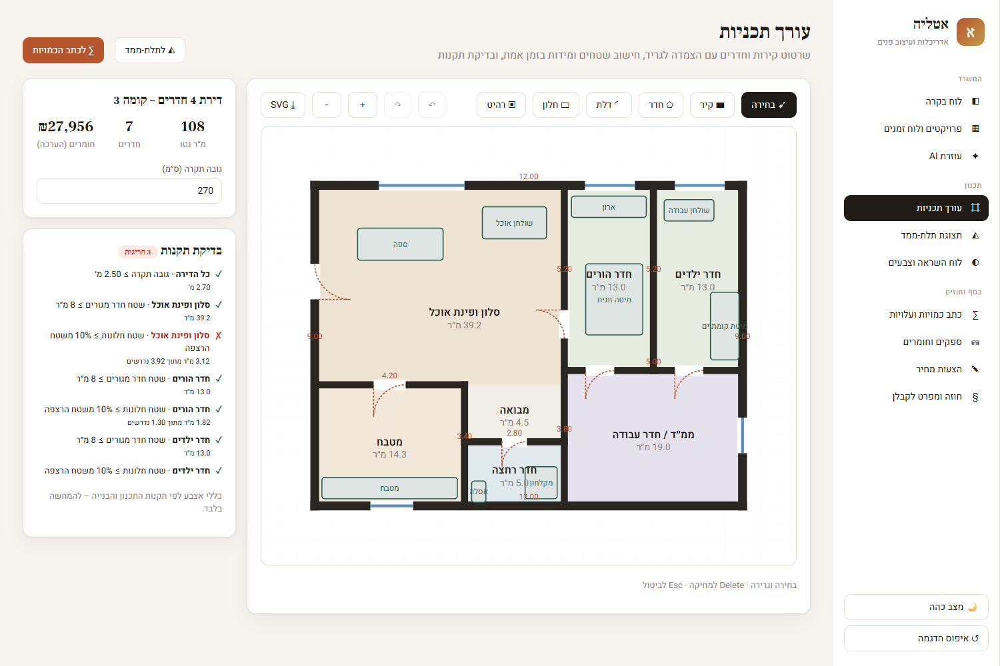
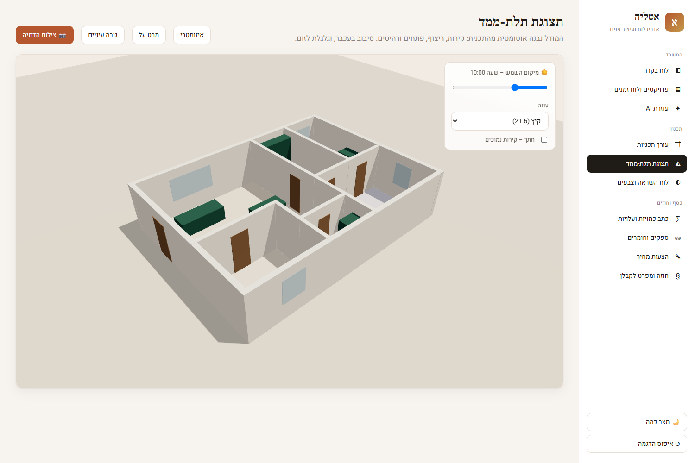
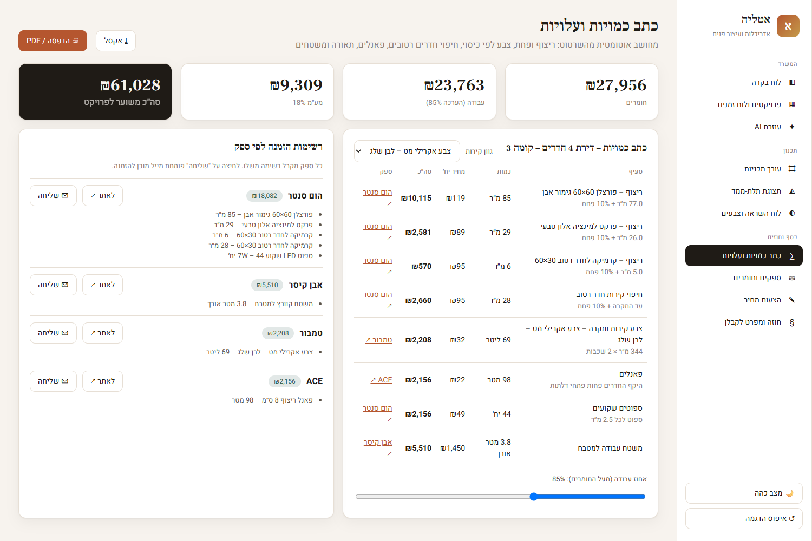
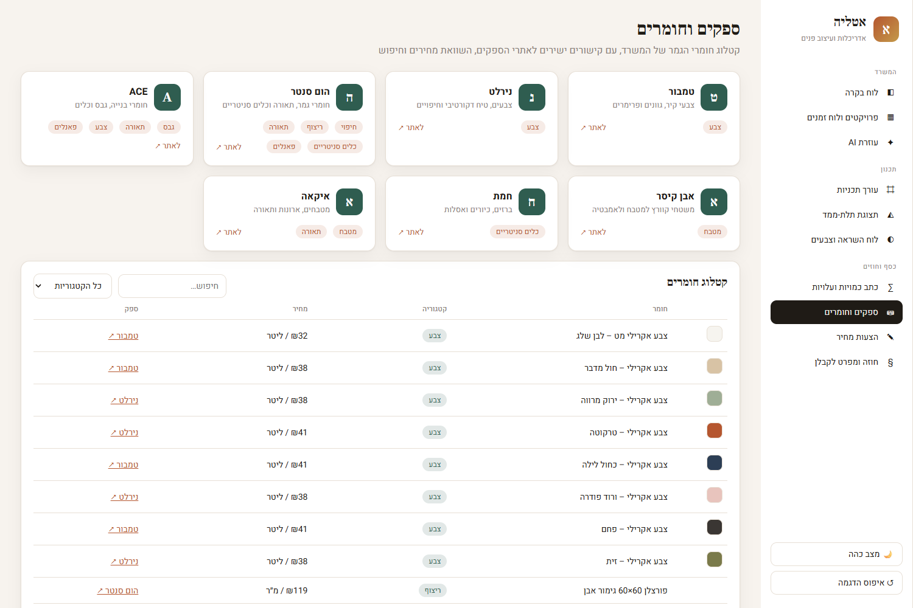
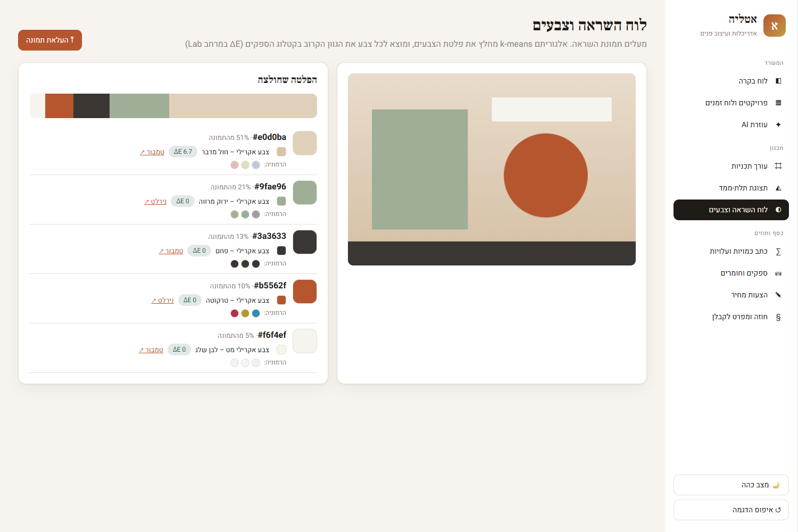
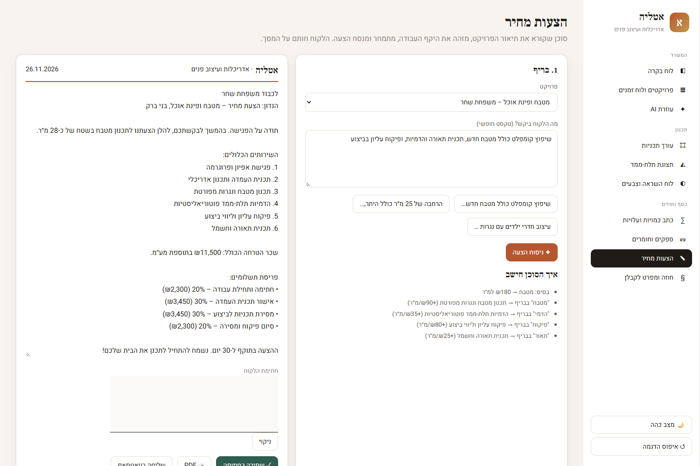
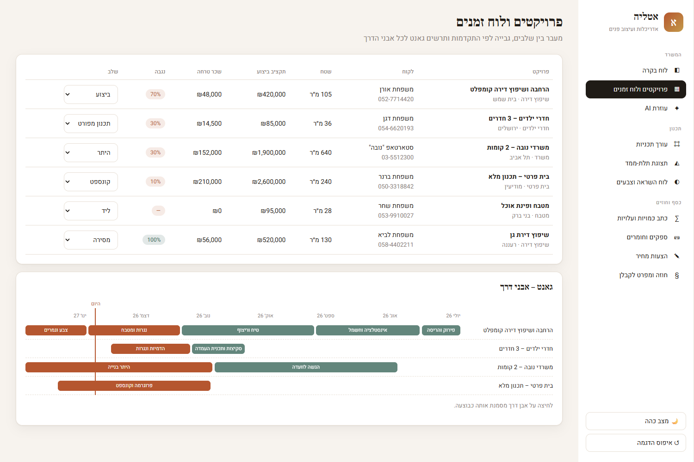

<div dir="rtl" align="right">

# 📐 אטליה – מערכת עבודה מלאה למשרד אדריכלות ועיצוב פנים

[](https://github.com/chavi-blizinsky/atelier-architecture-studio/actions/workflows/ci.yml)

**🔗 אתר חי:** https://chavi-blizinsky.github.io/atelier-architecture-studio/

מערכת אחת שמחליפה את אוסף התוכנות שאדריכלית עובדת איתן ביום-יום: **שרטוט תכניות**, **תלת-ממד עם מסלול השמש**, **כתב כמויות ועלויות**, **ספקי חומרי בנייה**, **לוח השראה עם התאמת צבעים**, **הצעות מחיר עם חתימה דיגיטלית**, **חוזה ומפרט לקבלן**, **ניהול פרויקטים וגאנט**, ו**סוכני AI**.

**צד לקוח:** Angular 18 (Standalone Components, Signals, Control Flow חדש, Lazy Loading) · Three.js · Canvas · SVG
**צד שרת:** C# · ASP.NET Core 8 (Minimal APIs, Clean Architecture) · Entity Framework Core · BackgroundService · xUnit

---

## ✨ מה המערכת עושה

### ⌗ עורך תכניות

- **שרטוט:** קירות וחדרים, עם הצמדה לגריד ולקווים ישרים או אלכסוניים (snap), ודלתות וחלונות בלחיצה על קיר.
- **רהיטים:** גרירה וסיבוב.
- **מידות בזמן אמת:** אורך כל קיר בזמן השרטוט, ושטח כל חדר בנוסחת Shoelace.
- **עבודה נוחה:** Undo/Redo (Ctrl+Z / Ctrl+Y), זום וייצוא ל-SVG.
- **בדיקת תקנות:** שטח חדר מגורים לפחות 8 מ״ר, חלונות לפחות 10% משטח הרצפה, גובה תקרה ואוורור בחדרים רטובים. כל אלה בודקים את עצמם תוך כדי שרטוט.

### ◭ תלת-ממד עם מחקר הצללה

- **מודל אוטומטי:** Three.js בונה את המודל מהשרטוט (קירות, ריצוף, חלונות מזכוכית, דלתות ורהיטים).
- **מחקר הצללה:** **מסלול השמש** לפי שעה ועונה (קיץ או חורף בקו הרוחב של ישראל), עם צללים רכים.
- **מבטים:** איזומטרי, מבט על וגובה עיניים, ומצב חתך.
- **ייצוא:** צילום ההדמיה כתמונה.

### ∑ כתב כמויות ועלויות

- **חישוב אוטומטי מהשרטוט:**
  - ריצוף עם 10% פחת.
  - צבע לפי שטח הקירות פחות הפתחים, בשתי שכבות ולפי כושר כיסוי.
  - חיפוי חדרים רטובים עד התקרה.
  - פאנלים בלי פתחי הדלתות.
  - ספוטים לפי שטח.
  - משטח למטבח.
- **סיכום כספי:** חומרים, עבודה, מע״מ וסה״כ.
- **רשימות הזמנה לכל ספק,** עם מייל הזמנה מוכן וקישור לאתר הספק.
- **ייצוא:** לאקסל ולהדפסה או PDF.

### ⛁ ספקים וחומרים

- **ספקים:** קטלוג עם קישורים לאתרים של טמבור, נירלט, הום סנטר, ACE, אבן קיסר, חמת ואיקאה.
- **חיפוש וסינון:** לפי קטגוריה.

### ◐ לוח השראה וצבעים

- **חילוץ פלטה:** מעלים תמונת השראה, ו-**k-means** מחלץ ממנה את פלטת הצבעים.
- **התאמה לקטלוג:** לכל צבע נמצא הגוון הקרוב ביותר בקטלוג הספקים, לפי מרחק **ΔE במרחב CIE Lab** (כמו שהעין רואה).
- **הרמוניה:** הצעות לצבעים משלימים ואנלוגיים.

### ✎ הצעות מחיר – סוכן + חתימה דיגיטלית

- **ניסוח ההצעה:** הסוכן קורא את בקשת הלקוח בטקסט חופשי, מזהה את היקף העבודה (היתר, מטבח, הדמיות, פיקוח, תאורה…), מתמחר ומנסח הצעה.
- **שקיפות:** הסוכן מראה **איך הוא חישב** כל רכיב.
- **חתימה ושליחה:** הלקוח חותם על המסך, ואפשר לשלוח את ההצעה בוואטסאפ או להדפיס PDF.

### § חוזה ומפרט לקבלן
- **חוזה התקשרות:** עם כתב כמויות שנבנה מהשרטוט, לוח זמנים, פיצוי מוסכם, עכבון ותקופת בדק.

### ▦ פרויקטים, גאנט ועוזרת AI

- **שלבים:** פייפליין מליד ועד מסירה, ומעקב גבייה לפי פרויקט.
- **גאנט:** תרשים של אבני הדרך.
- **עוזרת AI:** סוכנת עם כלים (יתרות פתוחות, דדליינים, סטטוס ועומס). עם מפתח Claude היא בוחרת כלים בעצמה (tool use), ובלי מפתח היא מנתבת כוונות בעברית.

---

## 🏗️ ארכיטקטורה

```
atelier-architecture-studio/
├── client/                         Angular 18
│   └── src/app/
│       ├── core/                   models · geometry (BOQ, regulations) · palette (k-means, ΔE) · agents · signal store
│       └── pages/                  planner (SVG) · viewer3d (Three.js) · estimate · moodboard · proposals · contracts …
├── server/                         ASP.NET Core 8 – Clean Architecture
│   ├── src/Atelier.Core            Domain + engines (Geometry, Quantities, Regulations, ProposalAgent) – בלי תלות בפריימוורק
│   ├── src/Atelier.Infrastructure  EF Core + SQLite (התכנית נשמרת כ-JSON), Seeder, BackgroundService לתזכורות
│   ├── src/Atelier.Api             Minimal APIs, ProblemDetails, Output Caching, Health checks, Swagger
│   └── tests/Atelier.Tests         xUnit – מנועים, כללים עסקיים ו-API מקצה לקצה
└── .github/workflows/ci.yml        בדיקות שרת + לקוח → פריסה אוטומטית ל-GitHub Pages
```

| Method | Endpoint | תיאור |
|---|---|---|
| GET | `/api/projects?stage=` | פרויקטים ויתרות |
| PUT | `/api/projects/{id}/stage` | מעבר שלב (כלל עסקי: אי אפשר לדלג → 409) |
| POST | `/api/projects/{id}/proposal` | סוכן הצעות המחיר |
| GET / PUT | `/api/plans/{id}` | שמירת השרטוט |
| GET | `/api/plans/{id}/quantities` | כתב כמויות מהשרטוט |
| GET | `/api/plans/{id}/regulations` | בדיקת תקנות |
| GET | `/api/suppliers` | קטלוג ספקים (Output Cache) |

## 🚀 הרצה מקומית
```bash
cd server && dotnet run --project src/Atelier.Api      # Swagger: /swagger
cd server && dotnet test
cd client && npm install && npx ng serve               # http://localhost:4200
cd client && npx ng test
```

> האתר החי רץ במצב הדגמה עם נתונים בדויים, שנשמרים בדפדפן. בדיקות התקנות הן כללי אצבע להמחשה בלבד.

</div>
